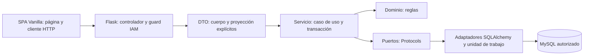

# Guía de lectura del código — organización real

Incremento0010 ABIERTO. Baseline Contexto Maestro v1.7, refinado por
[ADR-D0-BE-01](../../backend/ADR_D0_BE_01_ORGANIZACION_CAPACIDADES.md) y la SPA
Vanilla aprobada. La separación de capas es **lógica dentro de cada dominio**;
no se exige una carpeta física por clase. Los archivos Python no se movieron.
Las antiguas37 carpetas vacías/caché se retiraron tras inventario, sin quitar
fuentes ni inicializadores canónicos. Cinco rutas de la plantilla ya no existían.

## Mapa por capacidad

Las rutas de la tabla parten de [backend/src/recon_platform](../../backend/src/recon_platform/).

| Dominio | Controlador HTTP / DTO | Servicio / dominio | Puertos | Persistencia / transacción |
|---|---|---|---|---|
| IAM | identidad/controlador_auth.py, controlador_usuarios.py / dto_auth.py, dto_usuarios.py, seguridad_http.py | servicio_cuentas.py, servicio_sesiones.py / usuario_plataforma.py, rol.py, sesion.py, credenciales.py | contratos_cuentas.py, contratos_sesiones.py | modelos.py, repositorio_cuentas.py, repositorio_sesiones.py / unidad_trabajo.py |
| Personas | personas/controlador.py / dto.py | servicio.py / persona.py, tipo_persona.py, tipos_documento.py | contratos.py, contratos_consultas.py | modelos.py, repositorio.py, lecturas.py / unidad_trabajo.py |
| Accesos | accesos/controlador_puntos.py, controlador_eventos.py / dto_puntos.py, dto_eventos.py | servicio_puntos.py, servicio_eventos.py / punto_acceso.py, evento_acceso.py | contratos_puntos.py, contratos_eventos.py, contratos_consultas.py | modelos_puntos.py, modelos_eventos.py, repositorio_puntos.py, repositorio_eventos.py, lecturas.py / unidad_trabajo_eventos.py |
| Edge administrativo | integracion_edge/controlador.py / dto.py | servicio.py / dispositivo_edge.py | contratos.py | modelos.py, repositorio.py / unidad de trabajo de auditoría inyectada |
| Auditoría general | auditoria/controlador.py / dto.py | servicio.py / evento_auditoria.py | contratos.py | modelos.py, repositorio.py / unidad_trabajo.py |
| Consultas | consultas/controlador.py / dto.py | servicio.py / resultado Dashboard | contratos.py y puertos públicos Personas/Accesos | unidad_lectura.py comparte snapshot; sin tabla de reporting nueva |

[Factory](../../backend/src/recon_platform/__init__.py) registra ocho blueprints,
extensiones y CLI; [composición](../../backend/src/recon_platform/composicion.py)
inyecta adaptadores por petición. Los servicios dependen de entidades/Protocols,
no de Flask/ORM. Los repositorios concretos hacen consultas/flush, sin commit
autónomo. El caso de uso decide confirmar o revertir mediante su unidad.
Los joins de adaptadores con modelos de otras capacidades son preexistentes;
no presentar el sistema como desacoplado físicamente al100%.

## Cuatro recorridos existentes

### Login y sesión humana

1. [LoginPage](../../frontend/src/pages/LoginPage.js) captura usuario/contraseña,
   ofrece ojo inline y limpia el campo al concluir. [sessionStore](../../frontend/src/auth/sessionStore.js)
   acepta identidad solo de login/me y conserva estado en memoria.
2. [api/index](../../frontend/src/api/index.js) prepara GET/auth/csrf;
   [http](../../frontend/src/api/http.js) envía cookie y X-CSRF-Token en POST/auth/login,
   nunca JWT en localStorage. La cookie es opaca; JS no lee la cookie HttpOnly.
3. [controlador_auth](../../backend/src/recon_platform/identidad/controlador_auth.py)
   valida transporte/cuerpo, límite de intentos y CSRF antes de autenticar.
   [GestionSesiones](../../backend/src/recon_platform/identidad/servicio_sesiones.py)
   llama al caso de credenciales, rota la sesión y guarda digest en persistencia.
4. [credenciales](../../backend/src/recon_platform/identidad/credenciales.py) usa
   scrypt. [seguridad_http](../../backend/src/recon_platform/identidad/seguridad_http.py)
   configura cookie Secure/HttpOnly/SameSite, relee cuenta/rol actuales y falla
   cerrado ante errores. Logout revoca solo su sesión; desactivar revoca todas.
   No mostrar valores de contraseña, cookie, HMAC, token o hash en el video.

### Consultar una Persona

1. Ruta /personas/:id: [DetailPage](../../frontend/src/pages/DetailPage.js) solicita
   GET/api/v1/personas/id; el cliente descarta una respuesta de identidad antigua.
2. [controlador Personas](../../backend/src/recon_platform/personas/controlador.py)
   exige SUPERADMIN/ADMINISTRADOR. GET no requiere token CSRF; las escrituras sí.
3. [AdministrarPersonas.consultar](../../backend/src/recon_platform/personas/servicio.py)
   valida actor e ID y pide el registro al puerto. El
   [repositorio](../../backend/src/recon_platform/personas/repositorio.py) consulta
   SQLAlchemy y devuelve entidad; el [DTO](../../backend/src/recon_platform/personas/dto.py)
   selecciona los campos públicos aprobados. OPERADOR no accede a esta ficha.
4. Persona no es UsuarioPlataforma ni enrolamiento. ACTIVO no significa acceso
   autorizado. Eliminar está bloqueado; desactivar conserva datos e historial.

### Registrar un evento manual

1. [ManualPage](../../frontend/src/pages/ManualPage.js) y
   [manualStore](../../frontend/src/access/manualStore.js) seleccionan Persona/Punto
   y movimiento, confirman y conservan una clave UUIDv4 para la declaración.
2. [controlador_eventos](../../backend/src/recon_platform/accesos/controlador_eventos.py)
   valida sesión, CSRF, cuerpo e Idempotency-Key. Los tres roles pueden registrar.
3. [RegistrarEventoManual](../../backend/src/recon_platform/accesos/servicio_eventos.py)
   descarta la lectura implícita del guard, revalida actor, bloquea Persona/Punto
   y consulta clave antes de exigir estados para una declaración nueva.
4. [evento_acceso](../../backend/src/recon_platform/accesos/evento_acceso.py) calcula
   jornada America/Bogota y secuencia. [repositorio_eventos](../../backend/src/recon_platform/accesos/repositorio_eventos.py)
   consulta último AUTORIZADO en el intervalo UTC de la jornada. Evento y auditoría
   se confirman juntos; error revierte ambos. UNIQUE resuelve carrera de clave;
   replay idéntico devuelve el evento original, incluso si el estado cambió después.
   No se implementa reconocimiento facial ni apertura de puerta.

### Cambiar login IAM (Macro D)

1. SUPERADMIN abre Editar usuario en
   [DetailActions](../../frontend/src/components/DetailActions.js); valida3–64,
   confirma y envía únicamente login por PATCH/iam/usuarios/id/login.
   Cambiar rol y estado son acciones independientes, no transacciones combinadas.
2. [controlador_usuarios.cambiar_login](../../backend/src/recon_platform/identidad/controlador_usuarios.py)
   aplica el guard SUPERADMIN/CSRF, cuerpo exacto y normalización. Códigos:
   400 inválido,403 permiso/objetivo protegido,404 no existe,409 duplicado,503 fallo.
3. [CambiarLoginUsuario](../../backend/src/recon_platform/identidad/servicio_cuentas.py)
   revalida actor y objetivo, protege SUPERADMIN inicial y consulta unicidad.
   [repositorio_cuentas](../../backend/src/recon_platform/identidad/repositorio_cuentas.py)
   hace flush; cambio y auditoría CAMBIAR_LOGIN pertenecen a una transacción.
4. Error de auditoría revierte el login. No-cambio no duplica auditoría. Se conserva
   ID, rol, estado, credencial y sesiones; me refleja el nuevo login porque relee
   la cuenta. La UI relee la ficha y bloquea reenvío incierto. MySQL del ensayo E
   tiene su informe propio; no atribuir resultados antes de verificarlo.

## Infraestructura, migraciones y scripts: por qué no se reescriben

- [app_wsgi](../../backend/deploy/app_wsgi.py): carga *_FILE solo bajo /run/secrets,
  exige destino db:3306/recon_container_0010 con su cuenta y cookie Secure.
  Solo el peer frontend puede declarar HTTPS mediante ProxyFix acotado.
- [Docker backend](../../backend/Dockerfile), [frontend](../../frontend/Dockerfile):
  dependencias Linux separadas de fuentes; Gunicorn sin root y Nginx con estáticos,
  sin Vite/Node en runtime. No crean tablas o cuentas al arrancar.
- [Compose](../../compose.yaml): perfil approved-runtime, API/DB internos y HTTPS
  loopback. [Nginx local](../../frontend/nginx.conf) acepta localhost/127.0.0.1;
  una variante Azure separada necesita FQDN exacto y TLS público externo.
- [Seis revisiones](../../backend/migrations/versions/)0001–0006: Persona,
  IAM, sesiones, datos administrativos, Puntos/Edge/auditoría y eventos manuales.
  El cuerpo histórico no se editó. [env.py](../../backend/migrations/env.py)
  ejecuta el entorno Alembic: importarlo no es una inspección inocua.
- [Scripts backend](../../backend/scripts/) verifican destinos/huellas y acotan
  respaldos/migraciones/integración. Documentarlos no autoriza ejecutarlos contra
  Windows. Separar --antes/--despues y recon_tests/recon_dev; no intercambiar sus
  precondiciones ni correr procedimientos históricos por conveniencia.
- [Pruebas unitarias](../../backend/tests/unit/) aíslan SQLite/dobles y contrato;
  [integración](../../backend/tests/integration/) exige MySQL autorizado. Ninguna
  prueba aislada demuestra por sí sola locks, TLS público o hardware.

## Inventario completo de módulos de aplicación

La matriz permite encontrar cada módulo; los archivos auxiliares/migraciones se
explican arriba sin reescribir su lógica. Los comentarios se añaden donde aclaran
responsabilidades o decisiones, no por línea. Ver también la matriz externa E2.

| Archivo | Responsabilidad y estado documental |
|---|---|
| [backend/src/recon_platform/__init__.py](../../backend/src/recon_platform/__init__.py) | Aplicación principal del backend del Proyecto Recon Facial.; YA DOCUMENTADO / GUIA SIN TOCAR |
| [backend/src/recon_platform/accesos/__init__.py](../../backend/src/recon_platform/accesos/__init__.py) | Capacidad Accesos: Puntos administrativos, eventos manuales y consultas por rol. No ejecuta hardware ni decide reconocimiento biométrico al importar.; AMPLIADO |
| [backend/src/recon_platform/accesos/contratos_consultas.py](../../backend/src/recon_platform/accesos/contratos_consultas.py) | Puerto público de lectura para reporting, sin exponer repositorios ORM.; YA DOCUMENTADO / GUIA SIN TOCAR |
| [backend/src/recon_platform/accesos/contratos_eventos.py](../../backend/src/recon_platform/accesos/contratos_eventos.py) | Puertos del registro manual: persistencia, auditoría y transacción. El caso de uso coordina bloqueo, idempotencia y commit sin depender del ORM.; AMPLIADO |
| [backend/src/recon_platform/accesos/contratos_puntos.py](../../backend/src/recon_platform/accesos/contratos_puntos.py) | Puertos de administración de Puntos y su auditoría. Las implementaciones SQLAlchemy se inyectan desde composición.; AMPLIADO |
| [backend/src/recon_platform/accesos/controlador_eventos.py](../../backend/src/recon_platform/accesos/controlador_eventos.py) | API web humana de EventoAcceso; no expone una frontera Edge.; YA DOCUMENTADO / GUIA SIN TOCAR |
| [backend/src/recon_platform/accesos/controlador_puntos.py](../../backend/src/recon_platform/accesos/controlador_puntos.py) | API administrativa de PuntoAcceso.; YA DOCUMENTADO / GUIA SIN TOCAR |
| [backend/src/recon_platform/accesos/dto_eventos.py](../../backend/src/recon_platform/accesos/dto_eventos.py) | Contrato MANUAL; las proyecciones por rol conservan su adaptador actual.; YA DOCUMENTADO / GUIA SIN TOCAR |
| [backend/src/recon_platform/accesos/dto_puntos.py](../../backend/src/recon_platform/accesos/dto_puntos.py) | Representación administrativa explícita de PuntoAcceso.; YA DOCUMENTADO / GUIA SIN TOCAR |
| [backend/src/recon_platform/accesos/evento_acceso.py](../../backend/src/recon_platform/accesos/evento_acceso.py) | Reglas funcionales de EventoAcceso; independientes de HTTP y persistencia.; YA DOCUMENTADO / GUIA SIN TOCAR |
| [backend/src/recon_platform/accesos/lecturas.py](../../backend/src/recon_platform/accesos/lecturas.py) | Consultas acotadas de Accesos para el puerto público de reporting.; YA DOCUMENTADO / GUIA SIN TOCAR |
| [backend/src/recon_platform/accesos/modelos_eventos.py](../../backend/src/recon_platform/accesos/modelos_eventos.py) | Mapeo ORM de EventoAcceso, sus referencias e idempotencia. Describe restricciones persistidas; las reglas de secuencia viven en dominio.; AMPLIADO |
| [backend/src/recon_platform/accesos/modelos_puntos.py](../../backend/src/recon_platform/accesos/modelos_puntos.py) | Mapeo ORM del catálogo PuntoAcceso. El modelo representa tablas; la entidad y el servicio validan cambios administrativos.; AMPLIADO |
| [backend/src/recon_platform/accesos/punto_acceso.py](../../backend/src/recon_platform/accesos/punto_acceso.py) | PuntoAcceso: ubicación administrativa, sin decisiones de EventoAcceso.; YA DOCUMENTADO / GUIA SIN TOCAR |
| [backend/src/recon_platform/accesos/repositorio_eventos.py](../../backend/src/recon_platform/accesos/repositorio_eventos.py) | Adaptador SQLAlchemy de eventos, búsquedas y proyecciones por rol. Realiza bloqueos y flush; el servicio posee la transacción y confirma o revierte.; AMPLIADO |
| [backend/src/recon_platform/accesos/repositorio_puntos.py](../../backend/src/recon_platform/accesos/repositorio_puntos.py) | Adaptador SQLAlchemy del catálogo de Puntos. Traduce errores de integridad y devuelve entidades sin commits autónomos.; AMPLIADO |
| [backend/src/recon_platform/accesos/servicio_eventos.py](../../backend/src/recon_platform/accesos/servicio_eventos.py) | Casos de uso del registro MANUAL y consultas de Accesos. Coordina actor vigente, bloqueo de Persona/Punto, clave idempotente, secuencia de jornada Bogotá y auditoría en una única transacción; no acciona puertas.; AMPLIADO |
| [backend/src/recon_platform/accesos/servicio_puntos.py](../../backend/src/recon_platform/accesos/servicio_puntos.py) | Casos de uso de Puntos: alta, edición, estado y consulta por permisos. Coordina repositorio y auditoría sin acoplar reglas administrativas a Flask.; AMPLIADO |
| [backend/src/recon_platform/accesos/unidad_trabajo_eventos.py](../../backend/src/recon_platform/accesos/unidad_trabajo_eventos.py) | Adaptador del límite transaccional del registro manual. Descarta la lectura previa del guard antes del bloqueo y expone commit/rollback.; AMPLIADO |
| [backend/src/recon_platform/auditoria/__init__.py](../../backend/src/recon_platform/auditoria/__init__.py) | Auditoría administrativa general de la plataforma.; YA DOCUMENTADO / GUIA SIN TOCAR |
| [backend/src/recon_platform/auditoria/contratos.py](../../backend/src/recon_platform/auditoria/contratos.py) | Puertos para persistir/consultar auditoría general y delimitar su transacción. No exponen sesiones ORM a los casos de uso.; AMPLIADO |
| [backend/src/recon_platform/auditoria/controlador.py](../../backend/src/recon_platform/auditoria/controlador.py) | Consulta restringida de eventos generales.; YA DOCUMENTADO / GUIA SIN TOCAR |
| [backend/src/recon_platform/auditoria/dto.py](../../backend/src/recon_platform/auditoria/dto.py) | Representación de auditoría general con selección explícita de campos.; YA DOCUMENTADO / GUIA SIN TOCAR |
| [backend/src/recon_platform/auditoria/evento_auditoria.py](../../backend/src/recon_platform/auditoria/evento_auditoria.py) | Evento de auditoría independiente de HTTP y persistencia.; YA DOCUMENTADO / GUIA SIN TOCAR |
| [backend/src/recon_platform/auditoria/modelos.py](../../backend/src/recon_platform/auditoria/modelos.py) | Mapeo ORM de EventoAuditoria general, distinto de las auditorías IAM y Personas. No incorpora credenciales ni material biométrico.; AMPLIADO |
| [backend/src/recon_platform/auditoria/repositorio.py](../../backend/src/recon_platform/auditoria/repositorio.py) | Adaptador SQLAlchemy de auditoría general. Agrega/consulta eventos y hace flush; la unidad de trabajo decide confirmar.; AMPLIADO |
| [backend/src/recon_platform/auditoria/servicio.py](../../backend/src/recon_platform/auditoria/servicio.py) | Caso de uso de consulta de auditoría general. Exige permisos administrativos y paginación; no implementa limpieza de historial.; AMPLIADO |
| [backend/src/recon_platform/auditoria/unidad_trabajo.py](../../backend/src/recon_platform/auditoria/unidad_trabajo.py) | Adaptador commit/rollback de auditoría general. Su instancia comparte la sesión de petición construida por composición.; AMPLIADO |
| [backend/src/recon_platform/composicion.py](../../backend/src/recon_platform/composicion.py) | Construcción por petición de casos de uso y adaptadores; no abre transacciones.; AMPLIADO |
| [backend/src/recon_platform/config.py](../../backend/src/recon_platform/config.py) | Configuración de la plataforma sin conexiones implícitas a MySQL.; YA DOCUMENTADO / GUIA SIN TOCAR |
| [backend/src/recon_platform/consultas/__init__.py](../../backend/src/recon_platform/consultas/__init__.py) | Consultas web humanas; no integra Edge ni altera datos de negocio.; YA DOCUMENTADO / GUIA SIN TOCAR |
| [backend/src/recon_platform/consultas/contratos.py](../../backend/src/recon_platform/consultas/contratos.py) | Límite de una lectura consistente compartida por capacidades.; YA DOCUMENTADO / GUIA SIN TOCAR |
| [backend/src/recon_platform/consultas/controlador.py](../../backend/src/recon_platform/consultas/controlador.py) | Endpoint aditivo P0 sin filtros ni acceso a datos Edge.; YA DOCUMENTADO / GUIA SIN TOCAR |
| [backend/src/recon_platform/consultas/dto.py](../../backend/src/recon_platform/consultas/dto.py) | Allowlists de respuesta; nunca serializar objetos/dicts completos por accidente.; YA DOCUMENTADO / GUIA SIN TOCAR |
| [backend/src/recon_platform/consultas/servicio.py](../../backend/src/recon_platform/consultas/servicio.py) | Dashboard P0: permisos y corte único; ninguna escritura de negocio.; AMPLIADO |
| [backend/src/recon_platform/consultas/unidad_lectura.py](../../backend/src/recon_platform/consultas/unidad_lectura.py) | Fotografía transaccional explícita; libera lecturas mediante rollback.; YA DOCUMENTADO / GUIA SIN TOCAR |
| [backend/src/recon_platform/extensions.py](../../backend/src/recon_platform/extensions.py) | Extensiones compartidas de la aplicación Flask.; YA DOCUMENTADO / GUIA SIN TOCAR |
| [backend/src/recon_platform/http/__init__.py](../../backend/src/recon_platform/http/__init__.py) | Adaptadores HTTP transversales del monolito. No contienen reglas de negocio ni abren conexiones al importar.; AMPLIADO |
| [backend/src/recon_platform/http/administrativo.py](../../backend/src/recon_platform/http/administrativo.py) | Validación HTTP común de las nuevas APIs administrativas.; YA DOCUMENTADO / GUIA SIN TOCAR |
| [backend/src/recon_platform/identidad/__init__.py](../../backend/src/recon_platform/identidad/__init__.py) | Identidades y autorización de acceso a la plataforma web.; YA DOCUMENTADO / GUIA SIN TOCAR |
| [backend/src/recon_platform/identidad/cli.py](../../backend/src/recon_platform/identidad/cli.py) | Bootstrap manual; jamás se ejecuta al importar o arrancar Flask.; YA DOCUMENTADO / GUIA SIN TOCAR |
| [backend/src/recon_platform/identidad/contratos_cuentas.py](../../backend/src/recon_platform/identidad/contratos_cuentas.py) | Contratos requeridos por los casos de uso de IAM.; YA DOCUMENTADO / GUIA SIN TOCAR |
| [backend/src/recon_platform/identidad/contratos_sesiones.py](../../backend/src/recon_platform/identidad/contratos_sesiones.py) | Puerto de almacenamiento de sesiones humanas opacas. Guarda digests y vigencia, actualiza actividad y revoca sin exponer tokens en claro.; AMPLIADO |
| [backend/src/recon_platform/identidad/controlador_auth.py](../../backend/src/recon_platform/identidad/controlador_auth.py) | Frontera HTTP de autenticación humana; la cookie solo porta un identificador.; YA DOCUMENTADO / GUIA SIN TOCAR |
| [backend/src/recon_platform/identidad/controlador_usuarios.py](../../backend/src/recon_platform/identidad/controlador_usuarios.py) | API administrativa IAM; las reglas y transacciones permanecen en casos de uso.; YA DOCUMENTADO / GUIA SIN TOCAR |
| [backend/src/recon_platform/identidad/credenciales.py](../../backend/src/recon_platform/identidad/credenciales.py) | Hash y verificación de contraseñas humanas sin persistir texto claro.; YA DOCUMENTADO / GUIA SIN TOCAR |
| [backend/src/recon_platform/identidad/dto_auth.py](../../backend/src/recon_platform/identidad/dto_auth.py) | Contratos explícitos de autenticación humana.; YA DOCUMENTADO / GUIA SIN TOCAR |
| [backend/src/recon_platform/identidad/dto_usuarios.py](../../backend/src/recon_platform/identidad/dto_usuarios.py) | Entrada administrativa exacta y salida de cuentas sin credenciales.; YA DOCUMENTADO / GUIA SIN TOCAR |
| [backend/src/recon_platform/identidad/limitador.py](../../backend/src/recon_platform/identidad/limitador.py) | Límite local y acotado de intentos HTTP; no almacena credenciales.; YA DOCUMENTADO / GUIA SIN TOCAR |
| [backend/src/recon_platform/identidad/modelos.py](../../backend/src/recon_platform/identidad/modelos.py) | Persistencia inicial de Rol, UsuarioPlataforma y auditoría IAM.; YA DOCUMENTADO / GUIA SIN TOCAR |
| [backend/src/recon_platform/identidad/repositorio_cuentas.py](../../backend/src/recon_platform/identidad/repositorio_cuentas.py) | Repositorios IAM: flush sin commits y traducción de integridad.; YA DOCUMENTADO / GUIA SIN TOCAR |
| [backend/src/recon_platform/identidad/repositorio_sesiones.py](../../backend/src/recon_platform/identidad/repositorio_sesiones.py) | Repositorio SQLAlchemy para sesiones de usuarios humanos.; YA DOCUMENTADO / GUIA SIN TOCAR |
| [backend/src/recon_platform/identidad/rol.py](../../backend/src/recon_platform/identidad/rol.py) | Rol único de una cuenta de plataforma.; YA DOCUMENTADO / GUIA SIN TOCAR |
| [backend/src/recon_platform/identidad/seguridad_http.py](../../backend/src/recon_platform/identidad/seguridad_http.py) | Adaptador HTTP de sesión, CSRF, roles y transporte.; AMPLIADO |
| [backend/src/recon_platform/identidad/servicio_cuentas.py](../../backend/src/recon_platform/identidad/servicio_cuentas.py) | Bootstrap, autenticación y administración exclusiva de SUPERADMIN.; AMPLIADO |
| [backend/src/recon_platform/identidad/servicio_sesiones.py](../../backend/src/recon_platform/identidad/servicio_sesiones.py) | Casos de uso de sesión humana: vigencia, CSRF, rotación y cierre. Usa tokens aleatorios, digests y HMAC; consulta cuenta/rol actuales por puertos. Los identificadores y credenciales no se registran en logs ni auditoría.; AMPLIADO |
| [backend/src/recon_platform/identidad/sesion.py](../../backend/src/recon_platform/identidad/sesion.py) | Vigencia de una sesión humana, independiente de Flask y MySQL.; YA DOCUMENTADO / GUIA SIN TOCAR |
| [backend/src/recon_platform/identidad/sesion_flask.py](../../backend/src/recon_platform/identidad/sesion_flask.py) | Impide crear por accidente la sesión firmada del lado del cliente de Flask.; YA DOCUMENTADO / GUIA SIN TOCAR |
| [backend/src/recon_platform/identidad/unidad_trabajo.py](../../backend/src/recon_platform/identidad/unidad_trabajo.py) | Una confirmación o reversión por caso de uso IAM.; YA DOCUMENTADO / GUIA SIN TOCAR |
| [backend/src/recon_platform/identidad/usuario_plataforma.py](../../backend/src/recon_platform/identidad/usuario_plataforma.py) | Cuenta web independiente de Persona y de la biometría.; YA DOCUMENTADO / GUIA SIN TOCAR |
| [backend/src/recon_platform/integracion_edge/__init__.py](../../backend/src/recon_platform/integracion_edge/__init__.py) | Administración del nodo Edge, sin protocolo ni hardware.; YA DOCUMENTADO / GUIA SIN TOCAR |
| [backend/src/recon_platform/integracion_edge/contratos.py](../../backend/src/recon_platform/integracion_edge/contratos.py) | Puertos para metadatos administrativos Edge, consulta de Puntos y auditoría. No fijan protocolo de Raspberry, reconocimiento facial ni sincronización.; AMPLIADO |
| [backend/src/recon_platform/integracion_edge/controlador.py](../../backend/src/recon_platform/integracion_edge/controlador.py) | API web administrativa de DispositivoEdge; no es contrato de la Raspberry.; YA DOCUMENTADO / GUIA SIN TOCAR |
| [backend/src/recon_platform/integracion_edge/dispositivo_edge.py](../../backend/src/recon_platform/integracion_edge/dispositivo_edge.py) | DispositivoEdge como entidad administrativa.; YA DOCUMENTADO / GUIA SIN TOCAR |
| [backend/src/recon_platform/integracion_edge/dto.py](../../backend/src/recon_platform/integracion_edge/dto.py) | Representación administrativa; no informa conectividad física.; YA DOCUMENTADO / GUIA SIN TOCAR |
| [backend/src/recon_platform/integracion_edge/modelos.py](../../backend/src/recon_platform/integracion_edge/modelos.py) | Mapeo ORM de DispositivoEdge administrativo y su Punto asociado. Estado y última comunicación no acreditan funcionamiento físico integrado.; AMPLIADO |
| [backend/src/recon_platform/integracion_edge/repositorio.py](../../backend/src/recon_platform/integracion_edge/repositorio.py) | Adaptadores SQLAlchemy de metadatos Edge y consulta de Puntos. Hidratan entidades y traducen integridad sin commits independientes.; AMPLIADO |
| [backend/src/recon_platform/integracion_edge/servicio.py](../../backend/src/recon_platform/integracion_edge/servicio.py) | Casos de uso de alta, nombre, estado y modo administrativos Edge. Validan permisos/referencias y coordinan auditoría; no ejecutan hardware.; AMPLIADO |
| [backend/src/recon_platform/personas/__init__.py](../../backend/src/recon_platform/personas/__init__.py) | Capacidad Personas: registro administrativo independiente de IAM y biometría. Registrar o activar una Persona no completa enrolamiento ni concede acceso físico.; AMPLIADO |
| [backend/src/recon_platform/personas/contratos.py](../../backend/src/recon_platform/personas/contratos.py) | Contratos que los casos de uso esperan de la persistencia.; YA DOCUMENTADO / GUIA SIN TOCAR |
| [backend/src/recon_platform/personas/contratos_consultas.py](../../backend/src/recon_platform/personas/contratos_consultas.py) | Consulta pública agregada; no concede acceso al catálogo administrativo.; YA DOCUMENTADO / GUIA SIN TOCAR |
| [backend/src/recon_platform/personas/controlador.py](../../backend/src/recon_platform/personas/controlador.py) | API HTTP administrativa de Personas; IAM valida sesión, rol y CSRF.; YA DOCUMENTADO / GUIA SIN TOCAR |
| [backend/src/recon_platform/personas/dto.py](../../backend/src/recon_platform/personas/dto.py) | Contrato administrativo de Personas; no incorpora reglas biométricas.; YA DOCUMENTADO / GUIA SIN TOCAR |
| [backend/src/recon_platform/personas/lecturas.py](../../backend/src/recon_platform/personas/lecturas.py) | Agregado de Personas sobre el modelo propio, sin filtrar estado.; YA DOCUMENTADO / GUIA SIN TOCAR |
| [backend/src/recon_platform/personas/modelos.py](../../backend/src/recon_platform/personas/modelos.py) | Tablas SQLAlchemy de Persona y TipoPersona; no son entidades de dominio.; YA DOCUMENTADO / GUIA SIN TOCAR |
| [backend/src/recon_platform/personas/persona.py](../../backend/src/recon_platform/personas/persona.py) | Reglas de identificación administrativa de una Persona.; YA DOCUMENTADO / GUIA SIN TOCAR |
| [backend/src/recon_platform/personas/repositorio.py](../../backend/src/recon_platform/personas/repositorio.py) | Persistencia de Personas sin confirmar transacciones por cuenta propia.; YA DOCUMENTADO / GUIA SIN TOCAR |
| [backend/src/recon_platform/personas/servicio.py](../../backend/src/recon_platform/personas/servicio.py) | Casos de uso administrativos de Personas, sin dependencia HTTP ni biométrica.; AMPLIADO |
| [backend/src/recon_platform/personas/tipo_persona.py](../../backend/src/recon_platform/personas/tipo_persona.py) | Clasificación principal de personas del prototipo.; YA DOCUMENTADO / GUIA SIN TOCAR |
| [backend/src/recon_platform/personas/tipos_documento.py](../../backend/src/recon_platform/personas/tipos_documento.py) | Catálogo de nuevas asignaciones; no restringe la lectura del legado.; YA DOCUMENTADO / GUIA SIN TOCAR |
| [backend/src/recon_platform/personas/unidad_trabajo.py](../../backend/src/recon_platform/personas/unidad_trabajo.py) | Límite de confirmación de los casos de uso de Personas.; YA DOCUMENTADO / GUIA SIN TOCAR |
| [frontend/src/access/format.js](../../frontend/src/access/format.js) | Etiquetas y filtros de Accesos: conserva jornada America/Bogota y límites UTC de consultas administrativas.; DOCUMENTADO |
| [frontend/src/access/manualStore.js](../../frontend/src/access/manualStore.js) | Estado del registro manual: protege preflight/envío y reutiliza una clave idempotente ante incertidumbre, sin reenvío automático.; DOCUMENTADO |
| [frontend/src/access/Movements.js](../../frontend/src/access/Movements.js) | Tabla de movimientos y detalle accesible; selecciona proyección administrativa o reducida sin inventar datos.; DOCUMENTADO |
| [frontend/src/access/projections.js](../../frontend/src/access/projections.js) | Comprueba las claves permitidas de OPERADOR y muestra hora aproximada; no promete anonimato absoluto.; DOCUMENTADO |
| [frontend/src/api/http.js](../../frontend/src/api/http.js) | Cliente HTTP único: cookie same-origin, CSRF en memoria y lista cerrada de escrituras. Un resultado incierto no se reintenta automáticamente.; DOCUMENTADO |
| [frontend/src/api/index.js](../../frontend/src/api/index.js) | Adaptador de endpoints /api/v1: valida IDs y confirmación de escrituras; no decide permisos del servidor.; DOCUMENTADO |
| [frontend/src/api/pagination.js](../../frontend/src/api/pagination.js) | Construye parámetros de paginación y filtros con URLSearchParams sin concatenar valores sin codificar.; DOCUMENTADO |
| [frontend/src/app.js](../../frontend/src/app.js) | Compone sesión, shell, páginas y stores; reemplaza y desmonta vistas cuando cambia identidad, rol o ruta.; DOCUMENTADO |
| [frontend/src/auth/permissions.js](../../frontend/src/auth/permissions.js) | Permisos de navegación por rol para experiencia de usuario; la autorización efectiva permanece en Flask.; DOCUMENTADO |
| [frontend/src/auth/sessionStore.js](../../frontend/src/auth/sessionStore.js) | Sesión del cliente en memoria: login/me definen identidad; épocas descartan respuestas antiguas y logout invalida lecturas.; DOCUMENTADO |
| [frontend/src/components/ConfirmDialog.js](../../frontend/src/components/ConfirmDialog.js) | Confirmación nativa con resolución única; cancelar/destruir devuelve rechazo y restaura el foco del control invocador.; DOCUMENTADO |
| [frontend/src/components/DetailActions.js](../../frontend/src/components/DetailActions.js) | Acciones de ficha y editor administrativo: login, rol y estado son operaciones separadas; SUPERADMIN y eliminación de Persona protegidos.; DOCUMENTADO |
| [frontend/src/components/Dialog.js](../../frontend/src/components/Dialog.js) | Ciclo del dialog nativo: foco inicial/retorno, Escape, Tab y bloqueo de scroll; destruir retira listeners.; DOCUMENTADO |
| [frontend/src/components/dom.js](../../frontend/src/components/dom.js) | Componentes DOM pequeños: datos externos se insertan como texto; no se interpretan como HTML ni se usa React.; DOCUMENTADO |
| [frontend/src/components/EligiblePersonSelector.js](../../frontend/src/components/EligiblePersonSelector.js) | Busca Personas elegibles por el endpoint acotado de Accesos; no concede permisos al catálogo administrativo.; DOCUMENTADO |
| [frontend/src/components/Fields.js](../../frontend/src/components/Fields.js) | Construye etiqueta/control/error asociados y aplica validación accesible; las reglas del negocio se verifican también en backend.; DOCUMENTADO |
| [frontend/src/components/Filters.js](../../frontend/src/components/Filters.js) | Filtros y paginación reutilizables; el formulario entrega valores a la vista sin ejecutar SQL o mutar el negocio.; DOCUMENTADO |
| [frontend/src/components/Icons.js](../../frontend/src/components/Icons.js) | SVG inline locales y decorativos; el botón o enlace contenedor aporta el nombre accesible.; DOCUMENTADO |
| [frontend/src/components/PointSelector.js](../../frontend/src/components/PointSelector.js) | Selector asíncrono paginado de Puntos: cancela lecturas obsoletas y no infiere una selección por defecto.; DOCUMENTADO |
| [frontend/src/components/Shell.js](../../frontend/src/components/Shell.js) | Marco autenticado con menú por rol, campana y Perfil de solo lectura; conserva foco al abrir acciones de cuenta.; DOCUMENTADO |
| [frontend/src/components/Table.js](../../frontend/src/components/Table.js) | Tabla semántica y enlaces de detalle accesibles; cada celda corresponde a un campo definido por la vista.; DOCUMENTADO |
| [frontend/src/components/writeFlow.js](../../frontend/src/components/writeFlow.js) | Coordinación de confirmación y escritura: bloqueo de doble envío, navegación y registro de resultados inciertos por identidad.; DOCUMENTADO |
| [frontend/src/dashboard/dashboardStore.js](../../frontend/src/dashboard/dashboardStore.js) | Resumen por identidad: valida la proyección de rol, invalida tras mutaciones y revalida por actividad sin polling.; DOCUMENTADO |
| [frontend/src/dashboard/formatJornada.js](../../frontend/src/dashboard/formatJornada.js) | Formatea la fecha civil de jornada sin convertirla al día del huso del navegador.; DOCUMENTADO |
| [frontend/src/main.js](../../frontend/src/main.js) | Entrada única Vanilla: carga Bootstrap/CSS local y monta la aplicación con sus páginas.; DOCUMENTADO |
| [frontend/src/navigation.js](../../frontend/src/navigation.js) | Barrera de navegación compartida: consulta borradores/escrituras en curso y confirma descartes antes de abandonar.; DOCUMENTADO |
| [frontend/src/pages/CreateResourcePage.js](../../frontend/src/pages/CreateResourcePage.js) | Altas administrativas de cuentas, Puntos y Edge: catálogo real, validación, confirmación y limpieza de contraseña.; DOCUMENTADO |
| [frontend/src/pages/DashboardPage.js](../../frontend/src/pages/DashboardPage.js) | Inicio renderizado desde el store de resumen; mantiene métricas administrativas y vista reducida de OPERADOR.; DOCUMENTADO |
| [frontend/src/pages/DetailPage.js](../../frontend/src/pages/DetailPage.js) | Ficha consultada por ID: descarta respuestas obsoletas, monta acciones autorizadas y relee tras guardar.; DOCUMENTADO |
| [frontend/src/pages/EventsPage.js](../../frontend/src/pages/EventsPage.js) | Historial e incidencias por rol; limita filtros de OPERADOR y conserva la selección administrativa en la URL.; DOCUMENTADO |
| [frontend/src/pages/IncidentPage.js](../../frontend/src/pages/IncidentPage.js) | Consulta el detalle de incidencia administrativo y representa campos explícitos, sin exponerlo al OPERADOR.; DOCUMENTADO |
| [frontend/src/pages/index.js](../../frontend/src/pages/index.js) | Registro de funciones de montaje por tipo de página; cada una devuelve su limpieza de eventos/lecturas.; DOCUMENTADO |
| [frontend/src/pages/ListPage.js](../../frontend/src/pages/ListPage.js) | Listados por recurso: filtros, paginación y columnas definidas; una consulta pendiente se cancela al desmontar.; DOCUMENTADO |
| [frontend/src/pages/LoginPage.js](../../frontend/src/pages/LoginPage.js) | Login institucional y ojo inline: conserva foco, bloquea doble envío y limpia la contraseña en error, fin de intento o desmontaje.; DOCUMENTADO |
| [frontend/src/pages/ManualPage.js](../../frontend/src/pages/ManualPage.js) | Formulario de declaración manual: consume selectores y store idempotente; no equivale a reconocimiento facial ni apertura física.; DOCUMENTADO |
| [frontend/src/pages/PersonFormPage.js](../../frontend/src/pages/PersonFormPage.js) | Alta/edición de Persona: ocho campos administrativos, catálogos reales y confirmación de valores o cambios antes de enviar.; DOCUMENTADO |
| [frontend/src/pages/resources.js](../../frontend/src/pages/resources.js) | Metadatos de listados y fichas: rutas, IDs, columnas y representación de nombres; no define entidades nuevas.; DOCUMENTADO |
| [frontend/src/people/personForm.js](../../frontend/src/people/personForm.js) | Reglas de los ocho campos administrativos y payload parcial; no incorpora cuentas, fotos ni enrolamiento.; AMPLIADO |
| [frontend/src/router.js](../../frontend/src/router.js) | Router History API: intercepta enlaces internos, consulta bloqueadores y desmonta la vista anterior; respeta atrás/adelante.; DOCUMENTADO |
| [frontend/src/routes.js](../../frontend/src/routes.js) | Catálogo de rutas SPA y permiso requerido; el guard de cliente complementa la autorización backend.; DOCUMENTADO |
